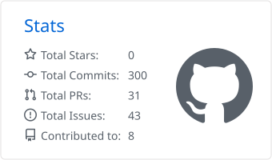
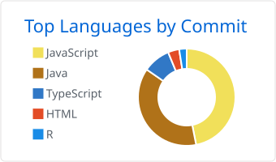
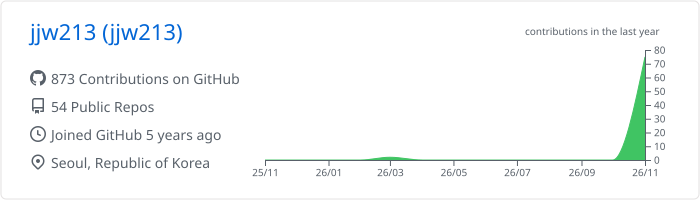

 

## 👋 About Me

**🇰🇷 Korean**
안녕하세요! **프론트엔드**와 **백엔드**를 모두 다루는 **풀스택(Full-Stack)** 개발자 장진우입니다.
현재 [**이수시스템**](https://www.isusystem.com/kor/index.do)에서 Java 개발자로 일하고 있습니다.

**🇯🇵 Japanese**
はじめまして！**Webアプリケーション**の開発を目指して成長しているフルスタック開発者です。
現在、[**株式会社 ISU SYSTEM**](https://www.isusystem.com/kor/index.do)で Java 開発者として働いています。

 

## 🏢 Career

| 기간 | 회사 | 역할 |
| :--- | :--- | :--- |
| 2023.01 ~ 현재 | **이수시스템** | Java 개발자 |
| 2022.08 ~ 2022.10 | **타라소프트** | 웹 개발자 |

 

## 🛠 Tech Stack

**Language**

  
  
  
  
  

**Frontend**

  
  
  
  
  
  
  

**Backend & Database**

  
  
  
  

**Tools**

  
  
  
  
  
  

**📖 Currently Studying**

  
  

 

## 📊 GitHub Stats

